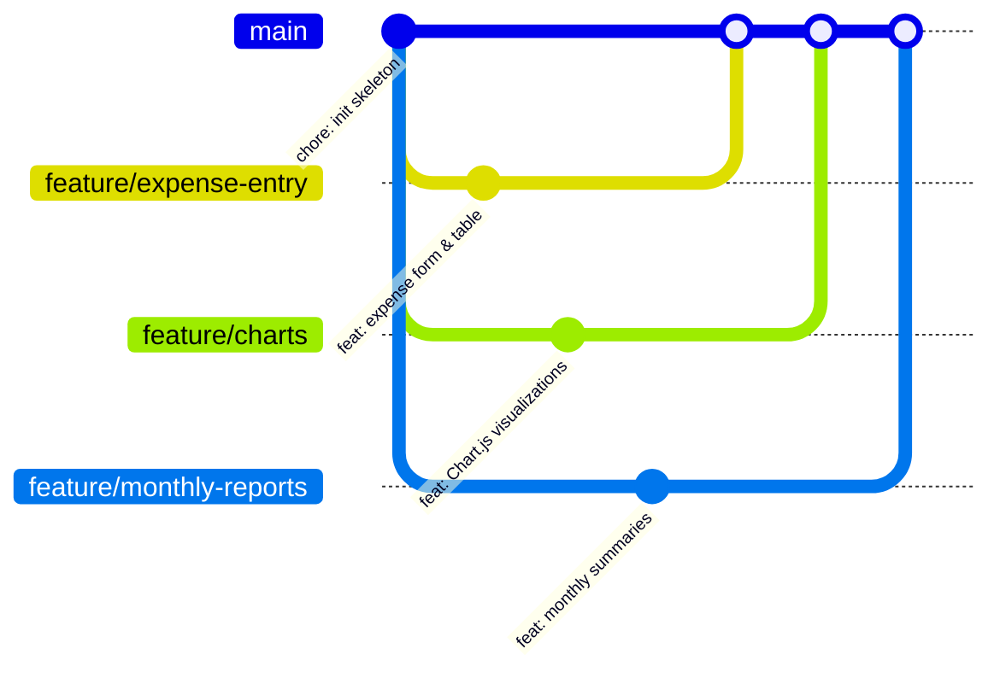

# Personal Expense Tracker

A modular, lightweight personal expense tracking dashboard built with Vanilla HTML5, CSS3, and JavaScript, designed specifically for a **Version Control System (VCS) end-term project**.

---

## 📌 Project Overview

This project is structured specifically to showcase modern Git workflow practices, isolated feature branching, clean commit histories, and modular web architecture without external build tooling.

### Key Architecture:
- **Zero Build Step:** Plain HTML, CSS, and modular ES6 JavaScript.
- **Shared Data Layer (`storage.js`):** `localStorage` persistence under the key `vcs_expenses` with pre-seeded sample data.
- **Event-Driven Reactivity:** A global custom event `expensesUpdated` coordinates updates across independent modules.
- **Isolated Modules:** Distinct script files allow independent development across isolated Git branches.

---

## 📂 File Structure

```text
personal-expense-tracker/
├── index.html         # Application shell with navigation tabs & placeholder mounts
├── style.css          # Modern, responsive design system (cards, typography, forms, tables)
├── storage.js         # Centralized localStorage data layer and sample data seeder
├── app.js             # Base controller (initializes storage, handles navigation & events)
├── entry.js           # [STUB] To be built on `feature/expense-entry`
├── charts.js          # [STUB] To be built on `feature/charts`
├── reports.js         # [STUB] To be built on `feature/monthly-reports`
├── .gitignore         # Ignores OS, IDE, and log artifacts
└── README.md          # Project documentation & VCS branching guide
```

---

## 🌿 Git Branching Workflow

This project is built around feature isolation using Git. Each module corresponds to a specific branch:



### Branches & Responsibilities:

| Branch | Target File(s) | Functionality |
|---|---|---|
| `main` | `index.html`, `style.css`, `storage.js`, `app.js` | Base skeleton, UI system, event broker, data layer. |
| `feature/expense-entry` | `entry.js`, `index.html` (mount) | Transaction entry form, validation, and recent transactions table. |
| `feature/charts` | `charts.js`, `index.html` (mount) | Chart.js doughnut chart (category breakdown) and bar chart (timeline). |
| `feature/monthly-reports` | `reports.js`, `index.html` (mount) | Monthly aggregate summaries, category filters, and CSV/print export. |

---

## 🚀 Step-by-Step Branch Development Guide

### 1. Working on Expense Entry
```bash
git checkout -b feature/expense-entry
# Implement entry form, input validation, and transaction list in entry.js
git add entry.js index.html
git commit -m "feat(entry): implement expense addition form and transaction history list"
```

### 2. Working on Analytics Charts
```bash
git checkout main
git checkout -b feature/charts
# Implement Chart.js rendering and dynamic category aggregations in charts.js
git add charts.js index.html
git commit -m "feat(charts): add category breakdown doughnut and monthly expense trend charts"
```

### 3. Working on Monthly Reports
```bash
git checkout main
git checkout -b feature/monthly-reports
# Implement monthly report aggregation and filtering in reports.js
git add reports.js index.html
git commit -m "feat(reports): implement monthly summary table and category breakdown report"
```

### 4. Merging Features Back to `main`
```bash
git checkout main
git merge --no-ff feature/expense-entry -m "merge: integrate feature/expense-entry"
git merge --no-ff feature/charts -m "merge: integrate feature/charts"
git merge --no-ff feature/monthly-reports -m "merge: integrate feature/monthly-reports"
```

---

## 🧪 Testing Locally

Simply open `index.html` in any modern web browser or run a lightweight local static server:
```bash
# Using Python
python -m http.server 8000

# Or open directly in Windows
start index.html
```
